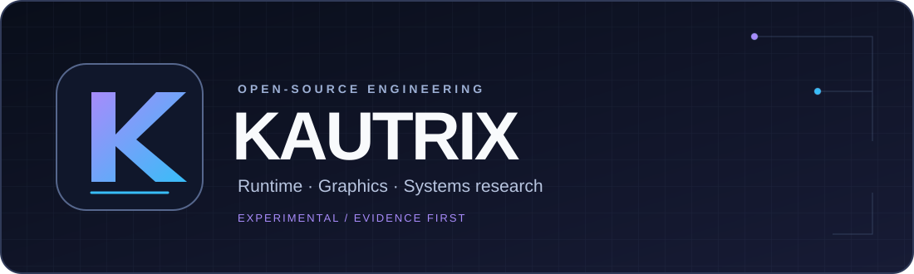

<p align="center">
  
</p>

<h1 align="center">Kautrix</h1>
<p align="center"><strong>Open-source runtime and graphics engineering.</strong></p>
<p align="center">RDNA2 decoding · SPIR-V translation · Vulkan integration · Reproducible research</p>

<p align="center">
  <a href="LICENSE"></a>
  <a href="#project-status"></a>
  <a href="https://github.com/ykauttiz/Kautrix/actions/workflows/ci.yml"></a>
  <a href="https://github.com/ykauttiz/Kautrix/actions/workflows/runtime.yml"></a>
  <a href="https://github.com/ykauttiz/Kautrix/actions/workflows/no-game-data.yml"></a>
</p>
<p align="center">
  <a href="#project-status">Status</a> ·
  <a href="#how-it-works">Architecture</a> ·
  <a href="#how-to-build">Development</a> ·
  <a href="docs/kautrix.md">Roadmap</a> ·
  <a href="docs/kautrix.pt-BR.md">Português (BR)</a>
</p>

---

## Overview

Kautrix is an independently maintained fork of [Leonida](https://github.com/Vyzerythe/Leonida), investigating static recompilation, graphics instruction translation and host runtime compatibility. Its engineering priorities are correctness, reproducibility, portability and transparent reporting.

> [!IMPORTANT]
> **Experimental research, not a playable PC port.** Game startup, universal compatibility and performance superiority have not been established. Kautrix is not affiliated with Rockstar Games, Take-Two or the upstream maintainers. No proprietary game data, keys or protection bypasses are distributed or requested.

## Project status

| Workstream | Maturity | Review / evidence |
| :--- | :--- | :--- |
| RDNA2 decoding | Under validation | [Integration PR #13](https://github.com/ykauttiz/Kautrix/pull/13) |
| MIMG register analysis | Proposed correction | [PR #25](https://github.com/ykauttiz/Kautrix/pull/25) |
| Sparse image TFE | Opt-in prototype, GPU validation pending | [Experimental branch](https://github.com/ykauttiz/Kautrix/tree/experiment/sparse-tfe-image-load) |
| Vulkan / host runtime | In development | [Architecture notes](docs/d3d12_vulkan.md) |
| Cross-platform CI | Outstanding failures | [Workflow runs](https://github.com/ykauttiz/Kautrix/actions) |
| Identity and website | In review | [PR #26](https://github.com/ykauttiz/Kautrix/pull/26) |
| Playable game / stable release | Not established | No compatibility claim |

Badges track the default branch, not draft PRs. Inspect the exact SHA and individual jobs before relying on any result. Upstream corpus measurements are not independently verified Kautrix benchmarks.

## How it works

```text
             Synthetic RDNA2 programs
                       |
              Instruction decoder
                       |
                Structured IR
                       |
             SPIR-V translation
                       |
              Vulkan / host runtime
                       |
          Independent verification
```

## Engineering focus

| Layer | Objective | Source |
| :--- | :--- | :--- |
| Decoder | Encoding and operand parity | [rdna2_decode.py](tools/rdna2_decode.py) |
| Shader IR | Consistent structured operands | [shader_ir.py](tools/shader_ir.py) |
| Translator | Control flow, image and wave semantics | [rdna2spirv.py](tools/rdna2spirv.py) |
| Runtime | ABI, resources and synchronization | [runtime/](runtime/) |
| Validation | Synthetic fixtures and regressions | [tests/](tests/) |
| Developer tools | Diagnostics and local viewer | [tools/](tools/), [viewer/](viewer/) |

## Platforms

| Platform | Development scope |
| :--- | :--- |
| Windows | Python tooling, native host runtime and CMake tests |
| Linux | Python tooling, portable runtime tests and Vulkan diagnostics |
| macOS | Python tooling, portable runtime tests and MoltenVK diagnostics |

These are development targets, not guarantees of game compatibility. See [testing documentation](docs/testing.md) for driver and toolchain requirements.

## How to build

Start with a synthetic development environment. No retail package is required for the checks below.

**1 — Clone the canonical repository**

```sh
git clone --recursive https://github.com/ykauttiz/Kautrix.git
cd Kautrix
```

### Synthetic development checks

**2 — Run focused Python checks**

```sh
python -I tests/test_shader_ir_parse.py
python -I tests/test_rdna2_decode.py
python -I tests/test_viewer_serve.py
python -I tests/test_docs_links.py
```

**3 — Run translator and portable runtime tests**

```sh
python -I scripts/run_semantic_tests.py tests/semantic
cmake -S runtime -B runtime/build
cmake --build runtime/build --config RelWithDebInfo
ctest --test-dir runtime/build -C RelWithDebInfo --output-on-failure
```

Install the dependencies specified in [docs/testing.md](docs/testing.md). These commands are a development guide, not a statement that the suites currently pass.

### Vulkan diagnostics on Linux

See [docs/testing.md](docs/testing.md) for Vulkan tools, synthetic GPU tests, driver constraints and platform-specific requirements.

### Running the loader on Linux

The inherited host loader and Wine integration are experimental. See [runtime/README.md](runtime/README.md) and the upstream technical reference below for architecture and limitations. No game startup result is implied.

## Fork verification

| Level | Evidence |
| :--- | :--- |
| E0 | Untested hypothesis |
| E1 | Static inspection |
| E2 | Local synthetic execution |
| E3 | Relevant cross-platform CI |
| E4 | Appropriate independent hardware or oracle evidence |

Record exact commit, reproduction, platform, toolchain and outcome. Failed, skipped and pending tests must not be reported as passing. Follow the [roadmap](docs/kautrix.md) and [Actions](https://github.com/ykauttiz/Kautrix/actions).

## Documentation

| Resource | Purpose |
| :--- | :--- |
| [Documentation index](docs/README.md) | Technical reference |
| [Engineering roadmap](docs/kautrix.md) | Priorities and acceptance gates |
| [Architecture contract](docs/design.md) | Shader and runtime contracts |
| [Testing](docs/testing.md) | Reproducible validation |
| [Website source](docs/index.html) | Responsive overview; not a deployed site |
| [Português (Brasil)](docs/kautrix.pt-BR.md) | Project introduction |
| [Community translations](docs/i18n/README.md) | Historical upstream guides |

## Compatibility and migration

The canonical repository is now `ykauttiz/Kautrix`. To update an existing clone of this fork without changing local files or branches:

```sh
git remote set-url origin https://github.com/ykauttiz/Kautrix.git
```

Legacy `LEONIDA_*` environment variables, executable names, module names, output directories and report schemas remain compatible until a tested migration is available. The independent project name does not imply an ABI change.

## Want to help?

Start with [issues](https://github.com/ykauttiz/Kautrix/issues), [pull requests](https://github.com/ykauttiz/Kautrix/pulls) and the [contribution guide](CONTRIBUTING.md). Prefer small patches with independent synthetic regressions; report AI-assisted work and disclose unverified cases. See [SECURITY.md](SECURITY.md) for responsible reporting.

Never upload game files, proprietary assets, keys, generated game shaders, credentials or sensitive logs. Do not bypass protections.

## Upstream technical reference

The [inherited README at the original fork baseline](https://github.com/ykauttiz/Kautrix/blob/de4c37383cad386eaa851047628d7b92c51009c5/README.md) retains historical measurements, detailed build notes and original links. The [upstream repository](https://github.com/Vyzerythe/Leonida) remains credited as the source of the original project. Historical results do not substitute for validation of current Kautrix commits.

## Credits

- [Leonida](https://github.com/Vyzerythe/Leonida) and its original contributors — foundational code and research.
- [Kautrix maintainers and contributors](https://github.com/ykauttiz/Kautrix/graphs/contributors) — fork development.
- [rpf9-explorer](https://github.com/breadbbbb/rpf9-explorer), [Mesa](https://gitlab.freedesktop.org/mesa/mesa), [Microsoft libHttpClient](https://github.com/microsoft/libHttpClient), [LLVM](https://llvm.org/) and [SPIRV-Tools](https://github.com/KhronosGroup/SPIRV-Tools) — inherited dependencies and references.
- SlyDevil — historical upstream logo ([source](https://www.steamgriddb.com/icon/122618)). The Kautrix mark is separate.

Original copyright notices and third-party license terms remain applicable. Grand Theft Auto and related marks belong to their respective owners.

## License

[GNU GPL v3 or later](LICENSE). Third-party components retain their own licenses. Distributed without warranty.

---

<p align="center"><strong>KAUTRIX</strong> · Independent engineering · Evidence before claims</p>
